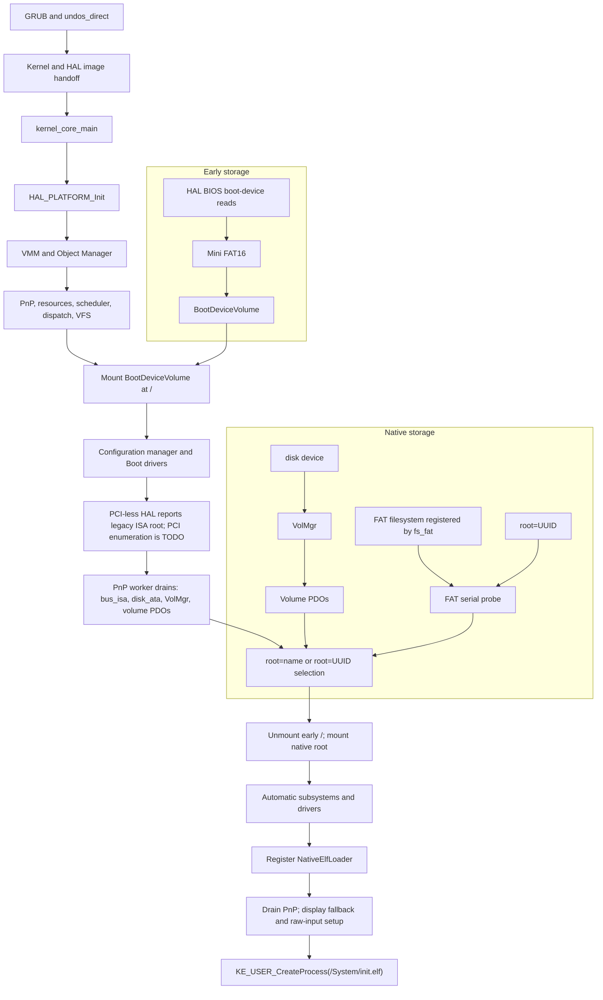

# Kernel architecture and boot

[Project overview](../README.md)

## Current boot path

The current image configuration invokes GRUB's `undos_direct` module with the
kernel and HAL images. The project is investigating a GRUB module instead of
Multiboot and plans a bootloader of its own, so the bootloader route is in flux.
The Stage 1.5 sources remain in the repository as a separate legacy target;
they are not the route in the current image configuration.

`kernel_core_main` calls `HAL_PLATFORM_Init` and initializes the Object Manager
before device discovery. It calls `init_boot_device_volume` before loading Boot
drivers. The boot-start set includes `bus_isa`, `disk_ata`, `volmgr`, and
`fs_fat`. `HAL_PLATFORM_AfterObjectManager` reports a legacy ISA root only when
it detects no PCI bus; PCI enumeration is not implemented. PnP processes
reported devices asynchronously, and
`KE_PNP_WaitForQuiescence` drains the queue before `root_volume_selector` and
`KE_VFS_Mount` select and mount the real root. See [Storage](Storage.md) for
the two storage paths.

The kernel's x86 HAL writes diagnostics to COM1 at 115200 baud, 8N1. It does
not write kernel logs to VGA memory. After device discovery and display
fallback, the kernel creates `/System/init.elf` and continues desktop startup.

## Stage responsibilities

| Component | Responsibility |
|---|---|
| GRUB direct loader | Loads the kernel and HAL images and performs the current handoff. |
| HAL | Initializes hardware-specific CPU, memory, interrupt, timer, and I/O support. |
| Kernel managers | Provide memory, objects, scheduling, resources, PnP, and VFS services. |
| Drivers | Discover devices, implement device I/O, and expose partition volumes or filesystem services. |
| ELoader | Loads a user executable and its shared objects before transferring control to the program. |

ELoader is linked at `0x08000000`. Native applications and shared libraries
use separate address ranges, as described in the [Application ABI](ApplicationABI.md).

## See also

- [System overview](Overview.md)
- [Storage and root mounts](Storage.md)
- [Plug and Play](PnP.md)
- [Process startup](ProcessStartup.md)
- [GRUB image configuration](../Image/grub.cfg.in)
- [Kernel entry and startup order](../Kernel/Source/src/main.cpp)
- [Stage 1.5 sources](../Kernel/HAL/x86_old/boot/trampoline.cpp)
- [Direct loader](../Boot/GrubDirect/grub_adapter.c)
