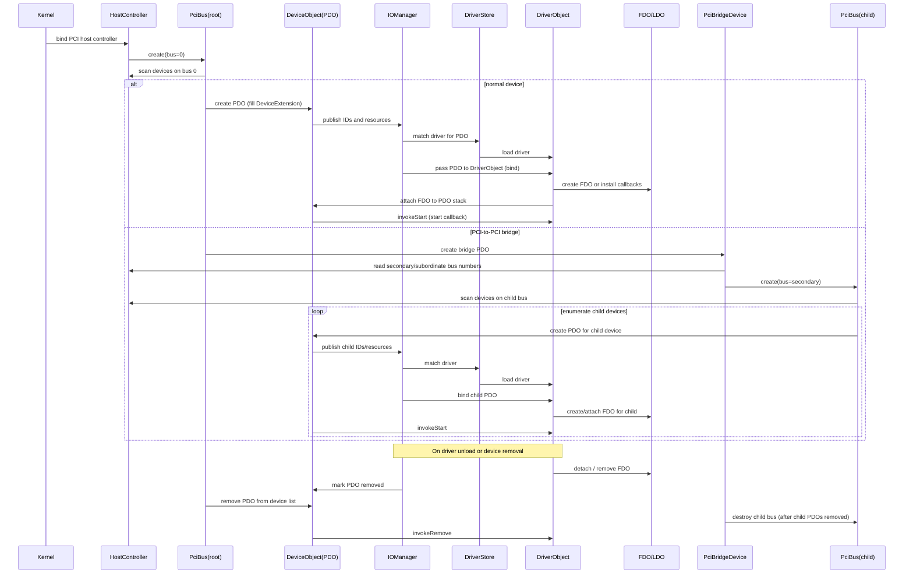

# Kernel roadmap

[Project overview](../README.md)

## Planned work

* [X] Implement initial GDT reload structure inside x86 HAL initialization sequence
* [X] Implement Object Manager
* [X] Implement scheduler
* [X] Implement VFS
* [X] Implement Driver Runtime (loading & executing)
* [ ] Complete early device tree parsing from `CONFIG.REG` file node arrays
* [ ] Make a HAL for ACPI x86
* [ ] Make a HAL for SMP devices
