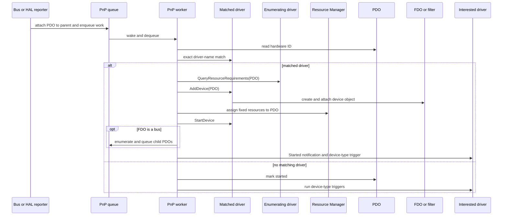

# Plug and Play

[Project overview](../README.md)

The owner's design rationale is that the NT model solved a real problem:
developers do not want ad-hoc device enumeration or manual IRQ and I/O conflict
handling, and its vocabulary is familiar to developers. This is the intent
behind the NT-inspired Plug and Play (PnP) model, not an implementation
guarantee or a claim of Windows NT compatibility.

## Report and bind a device

A bus or the HAL reports a Physical Device Object (PDO) with
`KE_PNP_ReportNewDevice`. Reporting attaches it to the parent device tree and
queues work; `PnPThread` calls `ProcessDevice` to perform identification and
binding asynchronously. The worker uses the PDO's explicit hardware ID or
asks its enumerating driver's `GetHardwareId` callback. It matches that string
to a registered driver's name exactly. The current x86 HAL reports a legacy
ISA root only when it detects no PCI bus; PCI enumeration is not implemented.

For a match, `ProcessDevice` first queries the enumerator for resource
requirements. It then calls the driver's `AddDevice` callback. After successful
binding, it assigns fixed resources through `KE_RES_AssignResources`. On
successful assignment, it calls `StartDevice` directly.
If the driver attaches a bus device, PnP enumerates its children. With no match,
PnP still marks the PDO started and runs registered device-type interests.

## Stack and start devices

PDO and Functional Device Object (FDO) describe roles in the current device
stack. Both use `KDevice`; `attachedDevice` and `lowerDevice` link devices in
the stack. `KDeviceBus` adds child enumeration. `AddDevice` commonly creates an
FDO and attaches it above the PDO. Device extensions hold per-device state.

## Device-type interests and limits

A driver can register interest in a device type. When a device starts,
`TriggerDeviceInterest` attaches each interested driver as an upper filter
with its `AddDevice` callback and starts it. VolMgr uses
`KE_PNP_RegisterDeviceInterest` to attach to Disk devices and produce Volume
PDOs.

The current implementation uses direct callbacks rather than an IRP dispatch
pipeline. Its Resource Manager reserves fixed grants and detects conflicts; it
does not implement the broader NT resource-arbitration model. PnP matching uses
an exact string comparison, and device-type interests are simple upper-filter
triggers. These are implementation contrasts, not a complete comparison with
Windows NT.

## See also

- [PnP manager](../Kernel/Source/src/pnp_manager.cpp)
- [PnP interfaces](../Kernel/API/include/kernel/pnp.hpp)
- [Device definitions](../Kernel/API/include/kernel/device.hpp)
- [Driver callbacks](../Kernel/API/include/kernel/kobject/KDriverObject.hpp)
- [Resource definitions](../Kernel/API/include/kernel/resource.hpp)
