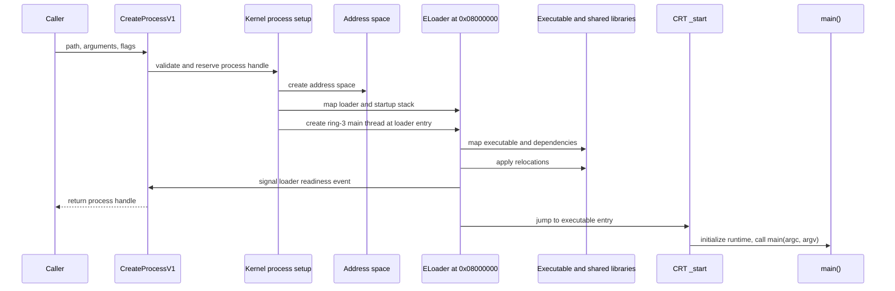

# Process startup

[Project overview](../README.md)

`CreateProcessV1` (syscall 200) creates a process and waits for ELoader to
finish mapping and relocating the program. It does not wait for constructors,
`main()`, or process exit.

## Create a process

`handle_CreateProcess_V1` passes the request to `KE_USER_CreateProcess`. The
kernel's `create_process` routine creates a process address space, maps ELoader at its
linked address `0x08000000`, builds a startup stack, and creates the process's
ring-3 main thread at ELoader's entry point. The kernel starts ELoader first;
ELoader then loads the requested application into that process.

## Load the program

`loader_main` opens the executable through VFS, validates and maps its ELF
image, then discovers and loads transitive `DT_NEEDED` shared libraries. It
applies standard relocations to the loaded images, then COPY relocations to the main
executable. After validating startup metadata, ELoader signals the creator's
readiness event and transfers control to the executable entry. A loader failure
exits before readiness, so process creation reports failure instead of
returning a successful handle to an uninitialized child.

## Reach main

The application's `_start` trampoline calls `crt_start` in `CRT/process.cpp`.
The CRT validates the startup block, runs preinitializers, initializes shared
libraries, runs executable constructors, and calls `main(argc, argv)`. Returning
from `main` starts the CRT's normal exit path.

The longer-term loader direction is one loader per executable environment.
DOS/16, DOS/32 with common-extender detection and 32-bit code extraction, and
possibly Win32 remain plans. They are not current process-startup paths.

## See also

- [CreateProcess syscall contract](../ABI/IDL/syscalls.txt)
- [Kernel process setup](../Kernel/Source/src/user_process.cpp)
- [ELoader](../Kernel/Loader/loader.cpp)
- [ELoader link address](../Kernel/Loader/linker.ld)
- [CRT entry](../CRT/start.S)
- [CRT lifecycle](../CRT/process.cpp)
- [Application ABI](ApplicationABI.md)
