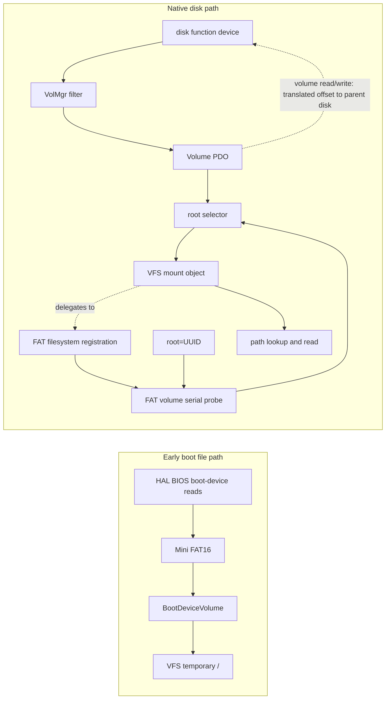

# Storage

[Project overview](../README.md)

UnDOS uses two storage paths during startup. The early path reads files needed
to load boot drivers. After device discovery, the native disk stack exposes
volumes, and the kernel mounts the selected volume as the root filesystem.

## Read the early boot volume

`init_boot_device_volume()` creates a synthetic `BootDeviceVolume` and mounts
it at `/` before the boot drivers load. Its filesystem uses `minifat::ReadFile`
and `HAL_BOOTDEV_ReadSectors` to read files from the BIOS boot device. Mini
FAT16 reads the first primary MBR partition and supports read-only 8.3-style
paths. This early volume is not a PnP disk or a partition discovered by
VolMgr. The native root later replaces its `/` mount.

## Follow disk I/O

A disk driver exposes a disk device. VolMgr registers interest in Disk
devices. When a disk appears, `VolMgr_AddDevice` attaches a filter and
`VolMgr_StartDevice` parses the disk's MBR or GPT partition table. It reports a
Volume PDO for each partition. Each volume carries its parent disk and a byte
range. Volume reads and writes translate the volume-relative offset into a
disk-relative offset.

`DriverEntry` in `fs_fat` registers the `FAT` filesystem and its
`FAT_MountVolume`, `FAT_ProbeVolumeId`, and VFS callbacks before root selection.
FAT is not PnP-bound to each Volume PDO. Root selection chooses a volume, then
the kernel asks FAT to mount it. VFS resolves paths through the longest
matching mount point.
`KE_VFS_OpenFile` delegates path lookup and handle creation to that mount's
filesystem; VFS read and write operations call the filesystem's callbacks.

## Select and mount root

Set `root=<device-name>` to resolve a device object by its exact name.
Set `root=UUID=XXXX-XXXX` to select by the 32-bit FAT volume serial number in
the volume boot record. This value is not a GPT partition UUID. The selector
requires exactly one matching FAT12, FAT16, or FAT32 volume with a valid serial.
The intended benefit is to select the same filesystem when disks move between
machines. A malformed selector, no match, duplicate serial, or probe error
stops boot. Cloned volumes can therefore make UUID selection ambiguous.

`kernel_core_main` performs selection, unmounts the early `/`, and mounts the
selected volume at `/` with `rootfs` (default `FAT`) and `rootops`, using
`KE_VFS_Unmount` and `KE_VFS_Mount`. It then rebinds the boot configuration
hive to the writable root. See the [full boot order](Architecture.md#current-boot-path)
for when these steps occur.

## See also

- [Boot-device volume](../Kernel/Source/src/initial/boot_device_vfs.cpp)
- [Mini FAT16 reader](../Kernel/Source/src/initial/mini_fat16.cpp)
- [Volume manager](../Kernel/Drivers/volmgr/volmgr.cpp)
- [FAT filesystem](../Kernel/Drivers/fs_fat/fat.cpp)
- [Root selector](../Kernel/Source/src/initial/root_volume_selector.cpp)
- [VFS interfaces](../Kernel/API/include/kernel/vfs.hpp)
