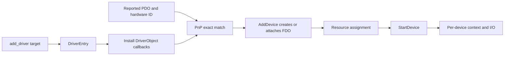

# Write a driver

[Project overview](../README.md)

This guide describes the current source-level contract for a kernel PnP driver.
Drivers are not yet stable; the example remains **TODO** and this document is
an orientation, not a ready-to-copy driver template.

## Minimal contract

Build the image with the `add_driver` CMake helper. Define the `DriverEntry`
function with `UNDOS_DRIVER_ENTRY`. For a PnP driver, install an `AddDevice`
callback during entry for devices it handles. `StartDevice` is called after the
resource grant when a matched device needs start-time initialization. The
registered driver's name must exactly match the device hardware ID supplied by
the PDO or its enumerator.

`AddDevice` normally creates a device object, attaches it above the PDO, and
stores per-device state in its device extension. Provide read, write, or other
I/O callbacks only when the device requires them. The file-system driver is a
different service: `fs_fat` registers filesystem callbacks and does not bind to
each Volume PDO as a PnP driver.

## Match and attach

`FindDriverForHardwareId` matches the registered driver name exactly, and
`ProcessDevice` calls `AddDevice` with the PDO. The callback may create an FDO
and attach it to the device stack. The `KDevice` object and its extension
provide the current device state. Keep mutable state per device when one driver
can own more than one device.

Use `KObjectPtr<KDriverObject>` for retained driver-object ownership.
`KDevicePtr<T>` is currently non-owning and does not keep a device alive.
Use `VirtualAddress` and `PhysicalAddress` to distinguish address spaces;
neither owns memory. See
[kernel memory and ownership](Development.md#kernel-memory-and-ownership)
before retaining a device reference or converting an address to a raw pointer.

## Resources and per-device state

An enumerating driver may provide resource requirements through
`QueryResourceRequirements` before binding. PnP passes those requirements to
the Resource Manager, which reserves fixed port, memory, interrupt, and DMA
ranges and rejects conflicts. `StartDevice` can read
the resulting assigned descriptors and initialize the hardware. For example,
`serial_uart` stores its I/O base and IRQ in an extension and reads assigned
resources, with defaults in this implementation.

## Build registration

Add the driver directory to `Kernel/Drivers/CMakeLists.txt` and call
`add_driver(target sources...)` from that directory's `CMakeLists.txt`. The
helper embeds the `.driver_name` metadata used by the loader. It links the
image with `Kernel/Drivers/driver.ld`, which sets `DriverEntry` as the entry
point and places the driver image in the kernel virtual range. This is a kernel
driver layout, not an application linker script. The normal kernel artifact
list controls which driver images are staged into the system image.

## Example (TODO)

A stable end-to-end example is **TODO**. For current patterns, inspect
`disk_fake` for an attached disk device with context, `bus_isa` for child
enumeration and resource requirements, and `serial_uart` for assigned-resource
lookup in `StartDevice`. These files illustrate current implementation, not a
stable public driver ABI.

## See also

- [Driver entry declaration](../Kernel/API/include/kernel/__core.hpp)
- [Driver object callbacks](../Kernel/API/include/kernel/kobject/KDriverObject.hpp)
- [Device definitions](../Kernel/API/include/kernel/device.hpp)
- [Resource definitions](../Kernel/API/include/kernel/resource.hpp)
- [Driver CMake helper](../BuildSupport/AddDriver.cmake)
- [Driver linker layout](../Kernel/Drivers/driver.ld)
- [Fake disk driver](../Kernel/Drivers/disk_fake/fake_disk.cpp)
- [ISA bus driver](../Kernel/Drivers/bus_isa/isa.cpp)
- [Serial driver](../Kernel/Drivers/serial_uart/serial.cpp)
