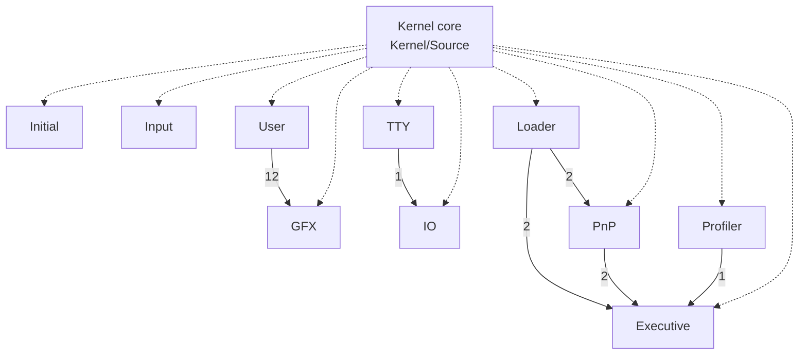

# Kernel components

Each folder here is one part of the kernel, built as a CMake object library and linked into the `kernel` executable. The kernel core in `Kernel/Source` (`main.cpp`, crt, `konsole`, syscall ABI glue) starts the components and links all of them.

## Layout

Every component follows the same pattern, set up by `undos_kernel_component(<target> <Name>)` in `Kernel/Source/CMakeLists.txt`:

- `include/kernel/<name>/`: public headers, exported by the `<Name>_Interface` target.
- `src/`: private sources and headers. Other components can't include them; the build fails if one tries.
- A component that needs another one links only its interface, for example `target_link_libraries(kernel_tty PRIVATE IO_Interface)`.

Shared types and the driver ABI stay in `Kernel/API`. Functions exported to drivers and modules must be declared with `UNDOS_KERNEL_PUBLIC_V1API`; `Kernel/Source/check_exports.py` enforces this after each link.

## Components

| Component | Target | What it does | Public headers |
|---|---|---|---|
| Executive | `kernel_executive` | Object manager, events, interrupt dispatch, scheduler, processes and memory. Split as one unit for now. | `kernel/executive/init.hpp`, `kernel/ps/`, `kernel/mm/`, `kernel/ob/`, `kernel/sched/` |
| IO | `kernel_io` | I/O objects and streams, VFS, DMA and the IO syscalls. | `kernel/io/adapters.hpp`, `kernel/io/vfs.hpp` |
| TTY | `kernel_tty` | Virtual terminals, TTY devices and their IO stream adapters. | `kernel/tty/tty_pump.hpp` |
| PnP | `kernel_pnp` | Device tree, driver binding, configuration hive and resource manager. | `kernel/pnp/` |
| Loader | `kernel_loader` | ELF images, boot and demand driver loading, subsystems, boot modules and the legacy ISA enumerator. | `kernel/loader/` |
| Initial | `kernel_initial` | Boot-time root volume: the boot-device FAT16 view and root volume selection. | `kernel/initial/` |
| Input | `kernel_input` | Kernel input manager (event ring, `\Device\Input` stream). | `kernel/input/input_manager.hpp` |
| Profiler | `kernel_profiler` | Optional `-finstrument-functions` profiler, built only with `UNDOS_PROFILE=ON`. Otherwise only `Profiler_Interface` exists, with inline stubs. | `kernel/profiler/profiler.hpp` |
| GFX | `kernel_gfx` | GDI: device contexts, drawing, fonts, displays, the software cursor and the scene lock. | `kernel/gfx/` |
| User | `kernel_user` | Windows, menus, message queues, painting and raw input. Registers a display-change handler with GFX. | `kernel/user/` |

## Dependencies

An arrow `A --> B` means sources of A include public headers of B. The number is the count of include sites. Dotted arrows show the kernel core, which includes every component to start it. The graph has no cycles.

<!-- BEGIN GENERATED GRAPH (Scripts/components_graph.py --update) -->

<!-- END GENERATED GRAPH -->

Some components also reach each other through exported `KE_*` functions without including a header (for example User calls `KE_INPUT_*`). Those links aren't in the graph; `Scripts/kernel_deps.py --objects <build-dir> --nm <gcc-nm>` lists them from the object files.

## Regenerating the graph

The graph is generated from the source code by `Scripts/components_graph.py`. It scans every `#include` in `Kernel/Components/*` and `Kernel/Source/src` and maps each `kernel/<folder>/...` include to the component whose `include/` folder holds that header.

```sh
python3 Scripts/components_graph.py            # print the Mermaid graph
python3 Scripts/components_graph.py --update   # rewrite the graph in this README
python3 Scripts/components_graph.py --check    # exit 1 if this README is out of date
```

The script also warns when a component includes another component's headers without linking its `<Name>_Interface` target. Run `--update` after adding a component or changing includes between components.

For a finer view, `Scripts/kernel_deps.py` reports the same edges at group level (it shows the object manager, processes and memory separately inside Executive), lists cycles, and fails on includes of another component's private headers.
