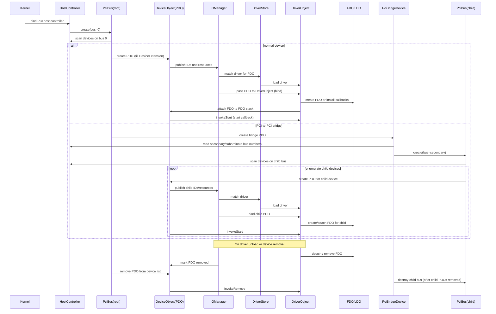

# UnDOS Operating System Core

Welcome to the **UnDOS** core architecture tree. UnDOS utilizes a decoupled design featuring a standalone **Kernel Core** and an architectural **Hardware Abstraction
Layer (HAL)**.

Rather than compiling the system into a monolithic binary or relying on complex runtime User-Mode/Kernel-Mode IPC for basic hardware initialization, UnDOS utilizes a
custom **Stage 1.5 Trampoline Engine** that dynamically cross-links static executables and sets up the high-half paging structures at boot time.

UnDOS is a lightweight, modular operating system targeting Intel 386, 486, and Pentium processors with goals to support ARM32, PPC, VAX, MIPS. It is written primarily
in modern C++, with a focus on simplicity, efficiency, and a familiar graphical environment.

## Goals

- **Retro Modernity:** Provide a modern modular OS architecture for retro x86 hardware; 386 and up.
- **Developer Experience:** Offer a clean and simple developer experience using modern C++.
- **Legacy Preservation:** Support classic DOS‑era software through compatibility layers.
- **Classic UI:** Deliver a lightweight GUI inspired by early Windows environments.

The core Kernel **must** be platform-agnostic and make calls to the HAL for anything platform-dependent.

Native applications and the user-mode ELF loader have separate virtual ranges:
applications start near `0x00010000`, while ELoader resides at `0x08000000`,
below the shared-library window at `0x10000000`. Its protected range is derived
from linker symbols, including page-rounded BSS, rather than a fixed 64 KiB
reservation. These virtual addresses do not reserve an equivalent amount of
physical memory.

## Kernel Architecture & Boot Pipeline

UnDOS uses a design philosophy closer to Windows NT than DOS or Windows 9x. Subsystems and drivers are cleanly separated to encourage modularity. Everything is treated as
an object, and the system relies on a namespaced standalone C++ standard library (`kstd`, derived and stripped from LLVM `libc++`).

The boot execution sequence shifts through four distinct environments before launching the kernel shell:

```text
[ GRUB / Multiboot 2.0 ]
        │
        ▼ (Loads Stage 1.5 ELF + Modules)
[ Stage 1.5 Trampoline ] ── (Parses headers, populates boot_info_t)
        │
        ▼ 
[ Kernel Core ] 
        |
        ▼ 
[ Hardware Abstraction Layer (HAL) ] ── (Initializes GDT/IDT/PIC/PIT/VMM)

```

### Stage Responsibilities

1. **Multiboot (GRUB):** Selects the target image, reads `grub.cfg`, configures raw 32-bit protected mode, and exposes the system topology map.
2. **Stage 1.5 (Trampoline):** Executes identity-mapped at physical `0x00100000` (1MB). It parses the raw Multiboot modules, maps sections to target physical frames,
   cross-stitches undefined references across binary barriers, sets up high-half tables, and enables the CPU MMU paging bit.
3. **HAL (`hal_x86_old`):** Executes in high-half space immediately following the Kernel Core. Handles ISA bus configurations, static non-PnP devices via `CONFIG.REG`,
   legacy PIC wiring, and basic interrupt context delivery.
4. **Kernel Core (`kernel`):** Executes in high-half space starting at `0xC0000000`. Architecture-agnostic payload containing the VFS, scheduler, Object Manager, NT-style
   personality subsystems, and high-level process execution engines.

## Memory Mapping Matrix

The Stage 1.5 loader maps the hardware memory architecture according to this physical-to-virtual layout layout contract:

| Subsystem Component            | Virtual Base Address (VMA)  | Target Physical Frame      | Mapping Scheme / Flags                    |
|--------------------------------|-----------------------------|----------------------------|-------------------------------------------|
| **Low-Memory Identity Line**   | `0x00000000` - `0x003FFFFF` | `0x00000000`               | Temporary Execution Coverage (`0x003`)    |
| **Stage 1.5 Runtime Base**     | `0x00100000`                | `0x00100000`               | Identity-mapped via GRUB                  |
| **Kernel Core Space**          | `0xC0000000`                | `0x01000000` (16MB)        | Supervisor, Present, Read/Write (`0x003`) |
| **Hardware Abstraction Layer** | `0xC0000000` + Kernel Size  | `0x01000000` + Kernel Size | Supervisor, Present, Read/Write (`0x003`) |
| **Recursive Directory**        | `0xFFC00000`                | Page Dir Physical          | Map slot 1023 straight into itself        |

## Executable & Compatibility Model

UnDOS treats **ELF** as its native executable format. While it uses absolute binaries for the Kernel and HAL, the Stage 1.5 loader implements **In-Place GOT Patching**
and runtime relocation handling. This allows these modules to be dynamically placed in memory while supporting cross-binary function calls through standard ELF
mechanisms:

* **`--emit-relocs`**: Retains internal relocation records (`.rel.text`, `.rel.data`) inside the output ELF executables.
* **`--unresolved-symbols=ignore-all`**: Permits the cross-compiler to generate an executable even if functions belonging to the matching binary are missing, designating
  them as `SHN_UNDEF` hooks for Stage 1.5 to patch at boot.

### Legacy Support

* **Native ELF:** Standard 32‑bit ELF binaries run directly on the kernel.
* **DPMI DOS Executables:** For common DOS extenders, UnDOS extracts the embedded 32‑bit binary and executes it inside an environment compatibility layer. This allows
  many legacy DOS applications to run natively without spinning up a full x86 real-mode emulation instance.

## The Handover Contract (`boot_info_t`)

Subsystems exchange environment layouts via a unified data ledger, evaluated dynamically by Stage 1.5 and pushed down the pipeline:

```c++
enum class MemoryRegionType : uint32_t {
  AVAILABLE = 1,   // Usable RAM for the PMM / Allocator
  RESERVED = 2,    // Hardware, ACPI tables, or bad memory
  ACPI_RECLAIM = 3,// Safe to reclaim after ACPI initialization
  BOOTLOADER = 4,  // Memory used by the bootloader itself
  KERNEL_STACK = 5 // Kernel stack memory
};

struct memory_region_t {
  uint64_t base;   // 64-bit bounds tracking to natively support PAE/x86_64 scaling
  uint64_t length;
  MemoryRegionType type;
};

struct boot_info_t {
  uint32_t page_size;
  uint32_t hal_more_into_addr;

  memory_region_t *memory_map;
  size_t memory_map_count;

  uintptr_t kernel_physical_start;
  uintptr_t kernel_physical_end;   // Calculated dynamically via PT_LOAD size
  uintptr_t kernel_virtual_start;
  uintptr_t kernel_virtual_end;     // The PMM uses this to safely align the allocation bitmap

  uintptr_t hal_virtual_start;
  uintptr_t hal_virtual_end;

  char *command_line;        // Raw boot flags forwarded from GRUB
};

```

## Graphical User Interface

The GUI is heavily inspired by GDI and the classic Windows 3.1 / Workgroups environment:

* Basic primitive window management and dirty rect z-ordering.
* Lightweight software pixel rendering pipeline optimized for retro VGAM/SVGA contexts.
* Simple, predictable, keyboard/mouse event focus structures.

### Native Program Manager session

Normal startup uses `init.elf` as a small supervisor for
`/System/progman.elf`. The shell loads `/System/PROGMAN.INI` and opens native
program-group windows. This is a native ELF shell, not Windows binary
compatibility. The `demo.elf` notes/argument exerciser and windowed `term.elf`
are included in the initial disk image.

Program Manager uses the classic gray MDI workspace, white group interiors,
32-pixel original program icons, and a compact File/Options/Window/Help menu
bar. Main opens at startup; the other configured groups appear as minimized
group icons. There is no taskbar or bottom status/help strip.

The shell requires a primary display of at least 640x480. Both Cirrus and
the planar VGA fallback use the same original bitmap font and classic palette.
Shared window decorations follow the NT 3.51 style: centered bold captions,
dark-blue active title bars, beveled gray frames, a system-menu box, and
triangle minimize/maximize controls. Maximized windows show paired restore
arrows; closing remains available through the system menu or Alt+F4.

Use arrow keys and Enter to select/run a program, Tab to open the next group,
and Page Up/Page Down to reach additional icons. F10 opens the menu; F1 opens
About. The File menu provides Run, group/program creation, properties, and
deletion. The Window menu reopens groups and arranges their windows.

**Settings are session-only.** The shipped configuration is read-only; editing
does not write FAT or claim to persist across reboot. Closing a group hides its
view without deleting its entries. The terminal has `help`, `clear`, `echo`,
`run`, and `exit` commands. `run /System/APP.elf [ARGS]` connects the child's
stdin, stdout, and stderr to the terminal's virtual TTY. While the child runs,
keyboard input goes to it, Enter commits a line, and Ctrl+D sends EOF (or
commits a partially typed line). The command prompt returns when it exits.
Closing the terminal closes its TTY source, releasing a child waiting for
input with EOF; it does not forcibly terminate the child.

Configuration records are bounded and versioned. Groups must precede their
items; IDs must be nonzero and unique across both kinds of record:

```text
version=1
group|1|Main
item|10|1|Terminal|/System/term.elf||0
item|11|1|Welcome|/System/demo.elf|"two words" second|1
```

There are at most six groups and 32 programs. Titles occupy at most 31
characters, executable paths 95, and argument strings 127. `|`, CR, and LF are
reserved delimiters. Use absolute executable paths and 8.3-compatible image
filenames. An invalid configuration is reported and opens an explicitly empty
recovery session rather than silently substituting successful-looking data.

Run `/System/init.elf --diagnostic` to select the preserved subsystem probes
instead of normal session supervision.

### User-controlled primary display

Adapter discovery does not select a graphics mode. `init` reads
`/System/DISPLAY.CFG` before starting the shell. The file contains four
whitespace-separated decimal values: `width height bpp refreshHz`, initially
`640 480 8 60`; refresh zero accepts any refresh rate. Missing, unreadable or
malformed configuration is an explicit startup error. If the requested mode
is not supported, init logs the mismatch and selects the first enumerated
mode (including the planar VGA fallback).

`EnumDisplayModesV1` (350) enumerates monitor-approved modes; its zero-based
ordinal is distinct from the returned opaque `modeId`. `available=0` marks
the end. `GetDisplayModeV1` (351) reports active/inactive state, generation and
current mode. `SetDisplayModeV1` (352) activates or switches the primary display.
Any application, including a future Control Panel, may request a switch:
there is no exclusive owner or authorization requirement yet. Mode changes
do not save configuration. EDID/default-monitor limits remain kernel-enforced;
the old `System\Console\Desktop` preference is no longer used.

`CreateDC(Primary)` opens the active root drawing surface, not a mode-control
lease. It returns `UNSUPPORTED` before activation rather than selecting mode
zero implicitly. Firmware output may remain visible until activation. Memory
DCs work independently. Existing screen DC handles survive mode changes, but
pixels are lost: USER refreshes clipping, pointer position, window placement
and desktop painting. Each window receives a coalesced `DisplayChange`
notification even if its message ring is full. Program Manager refits its
frame and workspace. Allocation failures preserve the previous mode; output
enable failure is explicit and queryable as an inactive programmed mode.

After building `BootIso`, `python3 tools/progman-smoke.py --scenario display
--output /tmp/undos-display` exercises a second process switching resolutions
and back while retaining a root DC. Repeat with `--vga std` for the single-mode
VGA path. Both use the bounded QEMU wrapper.

### Split TrueType infrastructure

The first part of [the split font plan](TTF_SPLIT_USER_KERNEL.md) is present:
an UnDOS-owned user-mode TrueType decoder emits bounded UFT1 resources, and
the kernel independently validates and retains an immutable private snapshot.
Uploads are transactional, generation-checked, quota-limited and reclaimed
when closed or when the process exits. No FreeType dependency is used.

Run `/System/fontload.elf` with argument `/System/Fonts/FTEST.TTF` from the
Program Manager Run dialog to exercise decoding, registration and cleanup.
The packaged font is original geometric test data, not a usable system font.
The loader explicitly reports **rendering unavailable**: the TrueType
interpreter, scalable rasterizer, shared glyph cache and GUI font selection
remain unimplemented. Existing bitmap text is unchanged.

## File System Notes

* **No Access Control Lists:** No ACL support implemented (and intentionally omitted for simplicity).
* **Minimal Attributes:** Only basic file flags (Read-Only, Hidden, System, Directory) are supported.
* **Permissions:** Permissions model is intentionally minimal for now to mirror vintage single-user desktop experiences.

## Developer

### Kernel error conventions

Stage 1.5 exports only default/protected global or weak ELF symbols, excluding
image-private hidden/internal definitions. Duplicate exports retain the first
definition, matching boot relocation lookup. Boot handoff and driver lookup
preserve symbol names up to 255 bytes; longer names fail explicitly rather than
being truncated into false duplicates.

Kernel operations report status with `kstd::error_code`; operations producing a
value use `kstd::expected<T, kstd::error_code>`. `kernel::KernelError` names the
kernel category's values and converts implicitly to an error code; other
subsystems can use their own categories. Check status codes with their boolean
conversion (zero means success), and compare specific failures with their
category-aware error codes. Propagate the original error
instead of replacing it with `false`, `nullptr`, a negative integer, or a
successful zero-byte transfer. Predicates and optional lookup results still
represent ordinary false/absent outcomes, and EOF remains a successful empty read.
Subsystems own their domain validation, including size and format limits; syscall
handlers adapt ABI arguments and resolve the caller's handles.

The kernel error category has permanent, allocation-free storage: error codes
may retain its reference for the kernel's lifetime. It does not register a
static destructor or depend on the application's `atexit` runtime.
The `kstd` generic and system categories also use permanent, allocation-free
storage without destructor registration, including when default-constructing
or clearing an error code.
Cross-image callers use the exported C-linkage `KE_ERROR_GetCategory` entry
point through the existing inline C++ helpers, so LTO cannot discard the category
accessor required by the HAL or drivers. It returns a non-null pointer at the
linkage boundary; C++ callers retain the reference-based category interface.
Freestanding library contract violations use the C-linkage `KE_RUNTIME_Panic`
hook, including pure-virtual calls; HAL and driver images do not depend on a
mangled C++ panic export.

Handwritten syscall handlers and generated internal dispatch functions return
`kstd::error_code`. Only the public dispatch boundary converts errors to the unchanged
`SyscallReturnCode` ABI through `kernel::KErrorToSysReturnCode`. The
mapper checks the category before interpreting its value;
unrecognized categories or errors without a truthful ABI equivalent return
`UNKNOWN`.

### Kernel log formatting

`KE_Print(message)` sends plain text directly to `KE_PrintBuffer`, without parsing
braces or using a formatting buffer. String literals and fixed arrays use a
bounded string view; dynamic strings and explicit views are also supported.

`KE_Print("Device {} at {x}", name, address)` packages arguments into a stack
array for a shared parser and integer conversion routine. Named output sinks
keep the formatter independent of the variadic argument pack. Formatting remains
allocation-free for early boot. The default 256-byte output buffer can be changed
with `KE_Print<Size>`; overflowing output ends in `...`, while an exact fit is
not truncated. Each call submits its message to `KE_PrintBuffer` once.

### Application ABI v1 (Phase 1)

This is the application contract for the planned UnDOS SDK on macOS, Windows,
and Linux hosts. It is **not the kernel/HAL ABI**. The startup, loader, runtime
lifecycle, ABI identification, and capability queries are implemented in-tree.
The installable sysroot, external CMake package, and Docker SDK are described
in Phase 2 below, compiler-driver defaults in Phase 3, and the initial standard
C library subset in Phase 4. This is not complete hosted ISO C/POSIX support.

#### CPU and C calling convention

Applications use little-endian i386 System V C conventions and ILP32:
`int`, `long`, and pointers are 32 bits, `long long` is 64 bits, and
`long double` uses the i386 12-byte storage representation. Use the i386
instruction baseline, not i686 instructions such as CMOV. At C function call
sites ESP is 16-byte aligned before CALL; the callee sees its return address
at ESP and arguments starting at ESP+4. EBX, ESI, EDI, EBP, and ESP are
callee-preserved, EAX/ECX/EDX are scratch, and the direction flag must be clear.
This does not imply Linux executable or syscall compatibility.

Floating-point operations use the x87 ABI, not a software-float calling
convention. `UD_SYS_QueryFpuV1` returns `FpuCapability_Unavailable`,
`FpuCapability_Native`, or `FpuCapability_Emulated`. Availability means usable,
per-thread managed support, not merely an installed coprocessor.
**It currently returns Unavailable**, including on CPUs with an FPU: native
x87 initialization/context preservation and the planned kernel FPU emulator
are not implemented. Do not execute floating-point code while unavailable.
Future emulation will retain this ABI and query, rather than requiring
applications to adopt another floating-point calling convention.

#### Executables, shared libraries, and ABI identification

The main application is an ELF32 little-endian `EM_386` `ET_EXEC`. Startup-loaded
shared libraries are `ET_DYN`, referenced by `DT_NEEDED`. ELoader performs eager
binding; no Linux interpreter or lazy-binding trampoline is used. `PT_INTERP`
and `PT_TLS` are rejected. TLS, `dlopen`/`dlclose`, exception unwinding, and a
complete C++ standard runtime are outside v1.

Every application and shared library must contain exactly one allocated
UnDOS ABI note covered by both a `PT_NOTE` and a `PT_LOAD` segment:

| ELF note field | Value |
|---|---|
| Name | `UnDOS` including its terminating NUL (`namesz = 6`, padded to 4 bytes) |
| Type | `1` |
| Descriptor | Two little-endian uint32 values: ABI version `1`, flags `0` |
| Descriptor size | `8` |

Missing, malformed, duplicate, or incompatible UnDOS notes reject before
application initialization. Unknown non-UnDOS notes are permitted.
All in-tree application/library images migrate together: **there is no legacy
binary allowlist**, because UnDOS has not shipped. ELoader itself is a kernel-
bootstrapped component, not a legacy application exemption; its private
kernel handoff is updated together with the CRT.

Dynamic objects use the System V hash table (`DT_HASH`) and ELF32 REL
relocations. Supported types are `R_386_NONE`, `R_386_32`, `R_386_PC32`,
`R_386_COPY`, `R_386_GLOB_DAT`, `R_386_JMP_SLOT`, and `R_386_RELATIVE`.
RELA relocation tables and unsupported relocation types reject.
RELR, symbol versioning, and indirect-function (IFUNC) symbols are unsupported
and reject rather than being interpreted as ordinary symbols.
Libraries are searched in the executable's directory, then `/System`;
dependency names cannot contain directory traversal. Dependency cycles reject.
Constructors run dependency-before-dependent, not merely reverse file
discovery order; finalization reverses initialization order.

Current loader limits are eight objects including the main executable,
32 direct dependencies per object, 16 program headers per object, and 4 MiB
of combined mapped image pages. Application mappings start at or above
`0x00010000`, below the `0xC0000000` kernel boundary, and cannot overlap ELoader
at `0x08000000` through its page-rounded linked end. Libraries occupy fixed
16 MiB virtual slots in the window starting at `0x10000000` (the first
dependency currently uses `0x11000000`). These are virtual ranges, not physical
RAM reservations. The initial stack allocation remains 16 KiB, including
startup data; no automatic growth, ASLR, or stack-guard guarantee is made.
**Image pages currently map user read/write/execute**; ELF segment flags
validate entry/callback addresses but do not yet establish W^X protections.
i386 also does not provide an NX bit.

#### Versioned process entry and arguments

The SDK-owned `_start` receives ESP aligned to 16 bytes, a zero reserved word
at ESP, and a pointer to `UnDOSStartupInfoV1` at ESP+4. There is no return
address to a caller and no Linux auxiliary vector. `_start` clears DF and
calls the CRT; normal applications implement `main(int argc, char **argv)`.
Other entry registers are unspecified.

`kernel_userland_shared/include/undos/abi.h` defines the public 48-byte
structure. Every field is a fixed-width uint32; address fields are process
virtual addresses, not host-sized pointers:

| Offset | Field | Contract |
|---|---|---|
| 0 | `size` | Exactly 48 for v1 |
| 4 | `version` | `1` |
| 8 | `argc` | Argument count, including argv[0] |
| 12 | `argv` | Address of argc+1 pointers, ending in NULL |
| 16 | `envp` | Address of an empty, NULL-terminated environment |
| 20 | `initialize_shared` | Loader callback, invoked once by the CRT |
| 24 | `finalize_shared` | Loader callback for normal-exit library cleanup |
| 28 | `flags` | Zero |
| 32 | `reserved[4]` | All zero |

Callbacks take no arguments and use the same C calling convention. The
startup-event handle is private loader bookkeeping, cleared from the entry
frame before application entry, and is not part of this public structure.
Startup strings and pointer arrays remain valid for the process lifetime.
The environment is exposed as `environ` but contains no inherited variables;
working-directory and relative-path API guarantees are deferred.

`argv[0]` preserves the executable path verbatim. Paths are nonempty and at
most 255 bytes; the command argument string is at most 1023 bytes. At most
32 arguments, including argv[0], are accepted. ASCII whitespace separates
arguments except inside double quotes; quotes are removed and adjacent quoted
and unquoted fragments concatenate. `""` is an empty argument. Backslashes
are literal: there is no escaping or shell expansion. Unmatched quotes,
embedded NULs, and overflow reject rather than truncate.

#### Runtime initialization, exit, and standard streams

The CRT validates startup size/version/reserved fields, caches standard
handles, exposes the empty environment, runs executable preinitializers,
invokes shared-library initializers, runs executable constructors, then calls
`main`. Static executable arrays are owned by the CRT; the loader owns
shared-library `DT_INIT`/`DT_INIT_ARRAY` and `DT_FINI_ARRAY`/`DT_FINI`.
Linker scripts retain initialization/finalization arrays and accommodate
the cross-compiler's `.ctors`/`.dtors` sections.

Returning from main calls `crt_exit` (`exit` is also supplied). Normal exit
runs registered `atexit`/`__cxa_atexit` callbacks in reverse registration
order, executable finalizers in reverse array order, then library finalizers
in reverse dependency order. `__cxa_finalize` prevents repeated callbacks and
supports DSO-specific selection. Registration is bounded to 128 pending
callbacks and returns failure when full; threading/TLS runtime guarantees
are not implied. Current CRT output is unbuffered, so no pending stream
buffers need flushing. `_Exit`/`crt_immediate_exit` and the Exit syscall
bypass cleanup. Reentrant normal exit takes the immediate path.

Zero means success. All 32 exit-status bits are preserved through
`UD_SYS_WaitProcessV1`; there is no implicit POSIX low-eight-bit truncation.
Loader failure exits with status 255 and is reported as process-creation
failure when it occurs before the readiness handshake. Readiness covers
mapping, relocation, dependency ordering, and loader lifecycle validation,
not completion of constructors or main.

Object-manager APIs use `HANDLE`, a C-compatible typedef of `uint32_t`, for
process, event, I/O and TTY handles. It is an opaque process-local token, not a
pointer; zero remains a valid handle. This naming does not change syscall wire
layouts or make integers and handles distinct compiler types. Graphics, window
and font-resource identifiers remain separate APIs.

**Never assume that handles 0/1/2 are standard streams.** Query
`UD_SYS_GetStdHandleV1` with `StdHandleSelector_Stdin`,
`StdHandleSelector_Stdout`, or `StdHandleSelector_Stderr`, then use the returned
opaque process-local handle. Closing a standard handle clears its mapping;
ordinary handle reuse does not recreate that mapping. Inheritable standard
streams preserve their identities when child handle values change.
Invalid selectors and unavailable streams return `INVALID_ARGUMENT`.
The CRT caches these queries at startup; unavailable streams do not prevent
GUI applications from starting. CRT output functions return `-1` on missing
streams, write failures, or formatting overflow; they do not silently fall
back to debug output. Explicit diagnostic output can use the debug syscall.
The terminal uses `UD_SYS_CreateProcessV2` (208) to supply explicit caller-local
stdin/stdout/stderr handles. It validates read/write access before launch and
creates independent child handles without inheriting unrelated handles.
`CreateProcessV1` keeps its existing inheritance behavior. TTY stdin waits for
committed input or EOF rather than treating an empty input queue as EOF.

#### ABI conformance workflow

Build `BootIso` as below, then run the hosted `[application-abi]`,
`[process-startup]`, and `[standard-handles]` tests. The real startup assembly
has an additional bounded opcode/alignment check:

```sh
python3 hosted_test/tests/process_startup_trampoline_test.py --build-dir build/abi-trampoline
python3 tools/progman-smoke.py --output build/abi-smoke --scenario abi
```

The emulator check uses `run-qemu.sh` and launches `init --abi-test` through
Program Manager. Its child checks quoted/empty arguments, initialized data
and BSS, empty environment, standard-handle queries, FPU capability reporting,
cross-library symbol resolution, dependency initialization, C++ destruction,
atexit, reverse finalization, immediate exit without cleanup, full-width exit
codes, and rejection of an
unmarked executable. The dependency fixture deliberately places a dependent
after its dependency in discovery order, so reverse-discovery initialization
would fail. Run emulator scenarios sequentially because they share the disk.

### Application SDK and Docker image (Phase 2)

See [SDK_ROADMAP.md](SDK_ROADMAP.md) for Docker release, cross-host validation,
and later runtime work.

The `sdk` CMake target builds and stages an application-only SDK. It can be
built without compiling the kernel, HAL, drivers, ELoader, or disk images.
Applications outside this repository use its installed CMake package; they
do not supply startup code, linker scripts, syscall glue, or freestanding
compiler/linker flags.

**This is not a full libc distribution.** The Phase 4 subset supports
`<stdio.h>`, `puts`, integer `printf`, allocation and strings. See its supported
function matrix below. C++ constructors and cleanup work,
but a hosted C++ standard library, exceptions, threading/TLS, and FPU execution
are not supplied. Missing stdout is an explicit I/O failure, not debug-console
output. Launch a console application with the terminal's `run` command to
provide its standard streams.

#### Build the Docker SDK

From the repository root, build the existing cross-toolchain image if it is
not already installed, then build the SDK image:

```sh
docker build -f DockerGccCross/Dockerfile -t gcc-standalone:i686-elf .
docker build -f sdk/Dockerfile -t undos-sdk:dev .
```

The first command builds GCC/binutils and can take substantially longer.
`sdk/Dockerfile` is a multi-stage build: its build stage compiles and installs
the SDK and checks relocated external examples; the final image contains the
base toolchain plus `/opt/undos-sdk`, without the UnDOS source tree or SDK
build directories. It currently reuses the full toolchain image, including
that image's OS-image utilities, rather than claiming to be a minimal runtime.
Override the prerequisite with `--build-arg TOOLCHAIN_IMAGE=YOUR_IMAGE`
when using a compatible image. For reproducible release builds, use a pinned
base-image digest instead of a mutable development tag.

Docker uses Linux containers on all supported hosts. Build both prerequisite
and SDK images for the same host/container architecture: Linux amd64 for
Intel/AMD hosts or Linux arm64 for Apple Silicon/ARM hosts. Both cross-compile
to **the same i386 UnDOS target**. Native macOS/Windows compiler executables
and published multi-architecture SDK images are not produced by this target.
No image is automatically pushed to a registry.

#### Build an external application

Create a directory containing just these two files:

```cmake
# CMakeLists.txt
cmake_minimum_required(VERSION 3.27)
project(HelloUnDOS LANGUAGES C)

find_package(UnDOS CONFIG REQUIRED)
add_executable(hello main.c)
target_link_libraries(hello PRIVATE UnDOS::Application)
```

```c
/* main.c */
#include <stdio.h>

int main(void) {
    return puts("Hello from UnDOS!") == EOF ? 1 : 0;
}
```

From that application directory, the following commands work in POSIX shells
and PowerShell (Windows Docker must be in Linux-container mode):

```sh
docker run --rm --mount "type=bind,source=${PWD},target=/work" undos-sdk:dev cmake -S . -B build-undos
docker run --rm --mount "type=bind,source=${PWD},target=/work" undos-sdk:dev cmake --build build-undos
```

The output is `build-undos/hello.elf`. The image sets `CMAKE_TOOLCHAIN_FILE`
to the installed SDK toolchain, which selects `i686-elf-gcc/g++`, the SDK
sysroot, and the UnDOS CMake platform. Do not execute the resulting ELF on
the host; deploy it to UnDOS. Keep container and native build directories
separate. On Linux, add `--user "$(id -u):$(id -g)"` to Docker invocations to
avoid root-owned files in bind mounts; this option is POSIX-shell-specific.

The installed package provides:

| CMake target | Purpose |
|---|---|
| `UnDOS::Application` | Application CRT, ABI note, entry object, default layout and compile/link defaults |
| `UnDOS::GUI` | GUI library plus application defaults |
| `UnDOS::Shared` | PIC shared-library defaults, ABI note and DSO cleanup object; no application entry point |
| `UnDOS::CRT` | Low-level runtime archive; normally use Application or GUI |
| `UnDOS::FontResource` | Shared UFT1 font-resource validation helpers; link alongside Application/GUI |

For a shared library, use `add_library(message SHARED message.cpp)` and link it
to `UnDOS::Shared`; link the executable to `message` and `UnDOS::Application`.
ELoader's startup-only shared-library rules still apply. CMake gives the
library a basename-only SONAME; use an 8.3-compatible output filename for the
current FAT driver. Do not set Linux runtime paths or install a Linux ELF
interpreter. The package supplies the bare-metal GCC-specific linker options
needed to produce real `ET_DYN` objects.

The image includes complete C, C++/shared-library, GUI, and runtime-probe
examples under `/opt/undos-sdk/share/undos/examples`. Copy an example into a
mounted application directory or configure it directly inside the container.

#### Stage or install the SDK without building an image

With a host-compatible `i686-elf` GCC/binutils toolchain on PATH, CMake 3.27+,
Python 3, and a build tool:

```sh
cmake -S . -B build-sdk --toolchain sdk/UnDOS-toolchain.cmake -DUNDOS_SDK_ONLY=ON -DCMAKE_BUILD_TYPE=Release
cmake --build build-sdk --target sdk --parallel
```

The result is `build-sdk/sdk/`. Set `-DUNDOS_SDK_PREFIX=/destination` when
configuring to change the staging destination. After building, a separate
installation is also supported:

```sh
cmake --install build-sdk --component SDK --prefix /destination
```

An ordinary OS cross-build also exposes the `sdk` target. Do not combine
`UNDOS_SDK_ONLY` with `TESTING_ONLY`. The SDK-only configuration does not
download hosted-test dependencies or require GRUB/QEMU.
IDE configurations that select `i686-elf-gcc/g++` directly are also accepted:
SDK validation checks the compiler's target, not just CMake's cross-compiling
flag. Hosted tests must instead use native compilers in a separate build
directory with `-DTESTING_ONLY=ON`.

The relocatable directory contains:

```text
sysroot/usr/include/       Public ABI, generated syscalls, CRT and GUI headers
sysroot/usr/lib/           Runtime/GUI archives, crt0.o, ABI/DSO objects, application.ld
bin/                      i686-undos-gcc and i686-undos-g++ SDK drivers
share/cmake/UnDOS/         Toolchain, platform module and find_package configuration
share/undos/              Examples and installed-SDK checks
```

Kernel-private headers and the compiler binaries are not part of this staged
directory. Moving it is supported, provided a compatible cross-compiler stays
on PATH. For non-container applications, explicitly configure with
`--toolchain /destination/share/cmake/UnDOS/UnDOS-toolchain.cmake`.
The Docker image is the ready-to-use compiler-plus-SDK distribution.

#### SDK verification

The Docker build compiles all installed examples after relocating the SDK to
a path containing spaces and checks ELF type, i386 architecture, ABI notes,
absence of Linux interpreters/TLS, shared dependency names, and exported
lifecycle symbols. Repeat from the final source-free image with:

```sh
docker run --rm undos-sdk:dev python3 /opt/undos-sdk/share/undos/check-sdk.py
```

For the runtime probe, create a host `build-sdk` directory and export the
probe binaries through a bind mount:

```sh
docker run --rm --mount "type=bind,source=${PWD}/build-sdk,target=/output" undos-sdk:dev python3 /opt/undos-sdk/share/undos/check-sdk.py --output /output/probe
```

Copy `probe/sdkcheck.elf`, `probe/sdkmsg.so`, and `probe/libcin.txt` into
`bin/filesystem/System/`, rebuild `BootIso`, then run:

```sh
python3 tools/progman-smoke.py --output build/sdk-smoke --scenario sdk
```

This launches an externally built SDK application and verifies heap/string
runtime functions, standard C file input and unavailable-output failures,
unoptimized C syscall bindings, shared-library initialization,
C++ destruction, atexit and
finalization using explicit debug diagnostics. Terminal stdio has a separate
`terminal-stdio` scenario. Existing image-page RWX permissions and
bare-metal toolchain executable-stack warnings are not fixed by SDK packaging.

### Compiler-driver defaults (Phase 3)

The installed SDK now includes `i686-undos-gcc` and `i686-undos-g++`. These
are relocatable Python 3 drivers over `i686-elf-gcc/g++`, not a new patched
GCC target. Put the SDK's `bin` directory and a compatible cross-toolchain on
PATH; the Docker SDK already sets both. The driver locates its sysroot relative
to its own installed location, not the current directory or source checkout.

For a source file using `<stdio.h>` and `puts`:

```sh
docker run --rm --mount "type=bind,source=${PWD},target=/work" undos-sdk:dev i686-undos-gcc hello.c -o hello.elf
```

No CMake project, linker script, CRT entry point, or freestanding flags are
required. `i686-undos-g++` likewise supports ordinary `main` and C++
construction/destruction without enabling hosted libstdc++, RTTI, or exceptions.
The initial standard C subset is described below; C++ standard-library headers
and floating-point execution are not provided. Standard output must actually be available;
missing streams continue to fail explicitly.

The drivers select the i386 baseline, target-only headers plus GCC's
freestanding builtin headers, the ABI note, startup/runtime objects, compiler
support library, and default application layout. They never search hosted
libc/libstdc++ headers implicitly. The CMake package and drivers implement the
same application ABI; CMake consumers may continue to use the Phase 2 toolchain
and imported targets.

Compile-only, preprocessing, assembly output, dependency generation, and
syntax checks do not add startup/link inputs. Partial links omit startup and
default libraries. Build archives with the cross-toolchain's `i686-elf-ar`:

```sh
i686-undos-gcc -c helper.c -o helper.o
i686-elf-ar rcs libhelper.a helper.o
i686-undos-gcc main.c libhelper.a -o application.elf
i686-undos-g++ -shared message.cpp -o message.so
i686-undos-g++ main.cpp ./message.so -o application.elf
```

Shared builds select PIC and DSO cleanup, omit application CRT startup, and
receive a basename-only SONAME derived from `-o` unless explicitly supplied.
Shared libraries resolve public runtime functions from the main executable;
they do not get independent copies of the process CRT. Both driver names
accept GCC-style response files, including quoted paths containing spaces.
For separately compiled shared-library objects, request `-fPIC` during their
compile step.

Low-level escape hatches deliberately allow creating nonconforming binaries:

| Option | Behavior |
|---|---|
| `-nostartfiles` | Omit ABI note and entry/DSO objects; retain default runtime libraries |
| `-nodefaultlibs` | Omit CRT/compiler support libraries; retain entry/ABI objects |
| `-nostdlib` | Omit both startup objects and default libraries |
| `-T` / `--script` through linker arguments | Replace the default application layout |
| `--undos-raw` | Pass arguments to the underlying compiler without SDK defaults |

These switches are for SDK/runtime work, not normal applications; callers
must supply a valid entry/lifecycle/note contract if they expect ELoader to
accept the resulting image. Compiler information queries such as `-dumpmachine`
describe the underlying `i686-elf` compiler rather than claiming a patched
UnDOS target.

The installed `check-sdk.py` also covers driver C/C++ compilation, compile-only
and partial-link modes, archives, response-file paths, shared SONAMEs, ABI
notes, failure propagation, and explicit startup suppression. Its exported
runtime probe is built with the drivers, so the `--scenario sdk` emulator check
exercises the command-line path as well as installed runtime objects.

### Initial standard C library (Phase 4)

The SDK extends the existing CRT rather than importing a separate libc. This
keeps one allocator, stream state and exit lifecycle per process, with no new
third-party dependency or additional upstream license/distribution obligations.
The libc implementation, allocator and memory/string primitives are C sources
compiled by the C compiler, including the legacy `crt_*` stdio helpers.
Core library code uses C11; syscall-facing code uses GNU C23 to consume the
existing generated syscall declarations and inline
assembly. Its private backend interface has C linkage, including when used by
the existing C++ CRT lifecycle/constructor support.
New code remains part of the repository under its existing project terms;
this is not a vendored or separately licensed libc port.

An ordinary hello-world source now builds through either the driver or the
CMake package, with no extra link flags:

```c
#include <stdio.h>

int main(void) {
    return puts("Hello from UnDOS!") == EOF ? 1 : 0;
}
```

```sh
i686-undos-gcc hello.c -o hello.elf
```

#### Supported-function matrix

| Header | Initial implementation |
|---|---|
| `stdio.h` | `FILE`, `stdin`, `stdout`, `stderr`, `EOF`; `fopen` (read-only `r`/`rb`), `fclose`; `fread`, `fwrite`, `fgetc`/`getc`/`getchar`, one-byte `ungetc`, `fgets`, `fputc`/`putc`/`putchar`, `fputs`, `puts`; `feof`, `ferror`, `clearerr`; `fflush`, `setvbuf`, `setbuf`; `printf`, `fprintf`, `vprintf`, `vfprintf`, `snprintf`, `vsnprintf`, `perror` |
| `stdlib.h` | `malloc`, `calloc`, `realloc`, `free`; `abs`, `labs`, `llabs`; `atoi`, `atol`, `strtol`, `strtoul`; `atexit`, `exit`, `_Exit`; `EXIT_SUCCESS`, `EXIT_FAILURE`; limited `abort`, `getenv`, `system` as described below |
| `string.h` | `memcpy`, `memmove`, `memset`, `memcmp`, `memchr`; `strlen`, `strcmp`, `strncmp`, `strcpy`, `strncpy`, `strcat`, `strncat`, `strchr`, `strrchr`, `strstr`, `strspn`, `strcspn`, `strpbrk`, `strtok`, `strerror` |
| `errno.h` | Process-global `errno`; `EIO`, `EBADF`, `ENOMEM`, `EINVAL`, `EMFILE`, `ERANGE`, `ENOSYS`, `EOVERFLOW` |
| `stdint.h`, `stddef.h`, `stdarg.h`, `limits.h` | Reused from the selected cross-GCC's freestanding builtin headers; the probe checks i386 ILP32, fixed-width integers, 8-bit bytes, and size limits |

This table is an explicit subset, **not full ISO C or POSIX conformance**.
Unlisted facilities such as `scanf`, `sprintf`, floating conversions,
locale/wide-character I/O, signals, time, threads/TLS, and hosted C++ libraries
are not supplied. `abort` terminates unsuccessfully without cleanup, but has
no SIGABRT delivery. ABI v1's environment is empty: valid `getenv` queries
return null. `system(NULL)` reports no command processor; non-null commands
fail with `ENOSYS`.

#### Formatting, streams and errors

Formatting supports `%s`, `%c`, `%%`, `%d`/`%i`, `%u`, `%o`, `%x`/`%X`, and
`%p` (hexadecimal with `0x`, including null). Integer length modifiers
`hh`, `h`, `l`, `ll`, `z`, `t`, `j`, flags `-+ #0`, decimal width/precision,
and `*` width/precision are supported. String precision limits bytes.
Wide strings/characters, floating conversions, and `%n` fail with `ENOSYS`;
unknown or incomplete conversions fail with `EINVAL`. Formatting can emit a
prefix before an error. Success returns the number of bytes produced;
`snprintf` returns the length that would have been written, terminates whenever
capacity is nonzero, and allows `(NULL, 0)` length queries. Output-count overflow
fails with `EOVERFLOW`. There is no legacy `crt_printf` 512-byte limit.

`puts` adds a newline; `fputs` does not. Streams start unbuffered. Output
supports full/line buffering selected before the first I/O; a supplied buffer
must remain valid until close/exit. A null buffer selects up to `BUFSIZ` bytes
of internal storage. Input is unbuffered; requesting buffered input fails with
`ENOSYS`. `fflush(NULL)` flushes all open output streams. Normal return/`exit`
runs callbacks/destructors then flushes output, while `_Exit` bypasses both.
Flush errors set the stream error flag and `errno`; they do not replace the
requested process exit status. `fclose` attempts flush and closes even on error.

Standard handles come from the startup runtime queries, never assumed handles
0/1/2. Missing handles fail with `EBADF`; errors returned by the current
kernel I/O API generally map to `EIO` because it does not distinguish all
filesystem failure reasons. `WriteV2` (syscall 226) preserves `WriteV1` and
reports actual bytes accepted, so stdio retries short writes and fails on
zero-progress writes. Bulk stdio is split into at most 4096-byte syscall
requests, respecting the current dispatcher limit. This SDK requires a kernel
with that additive syscall.
The original `crt_*` APIs remain available and unchanged.

`fread`/`fwrite` return complete element counts and reject multiplication
overflow. EOF and error flags are distinct and sticky until `clearerr`;
successful `ungetc` clears EOF. A successful zero-byte backend read marks EOF.
The current stream API cannot distinguish temporarily empty device queues
from EOF, so interactive readiness/blocking is not a libc guarantee.
Use filesystem streams or a controlled input provider for deterministic input.

Only read-only `fopen` is supported: write/append/update modes fail with
`ENOSYS` rather than pretending that VFS creation/truncation guarantees exist.
`fseek`/`ftell` also fail with `ENOSYS`; filesystem mutation, seek semantics,
and POSIX file descriptors/process APIs are not promised. Paths follow the
existing VFS rules (including short filenames); the libc does not create a
working-directory abstraction. VFS read failures propagate through the syscall
status separately from successful EOF or short reads.

The allocator reuses the CRT page arenas/free list, now with 16-byte alignment.
Zero-size allocation returns null; failed growth preserves the original
allocation. Size overflow/allocation failure sets `ENOMEM`. Arenas grow in
at least 64 KiB chunks and remain mapped until process teardown. Stream storage
is a fixed `FOPEN_MAX` (16) slot table with a 256-byte internal buffer per slot;
formatting uses bounded stack buffers rather than allocating a formatted copy.
The initial library is not thread-safe (`errno`, allocator, streams, `strtok`,
and callback tables have process-global state).

#### Coverage and terminal integration

`python3 sdk/tests/check-libc.py` compiles the actual library and CRT lifecycle
with controlled I/O/page providers at `-O0` and `-O2`, using an ordinary C test
caller. The library and controlled backend are compiled separately by the C
compiler as strict C11 with pedantic errors; only the existing C++ lifecycle
module uses the C++ compiler. It verifies exact hello-style output/newlines, input/EOF/errors, short
and zero-progress writes, partial flush recovery, truncation and integer limits,
allocation failure/overflow, stream exhaustion, normal-exit callback/flush
ordering, and `_Exit` bypass. It is also registered as hosted CTest
`libc_streams`. Test symbols are renamed to avoid interposing the host libc.
Run the registered test with
`ctest --test-dir <host-build>/hosted_test -R libc_streams --output-on-failure`.

The installed SDK checker builds the standard hello example and a C runtime
probe. `--scenario sdk` exercises formatting, allocation, file input, the real
versioned write syscall and unavailable stdout in UnDOS. **Valid stdout output
is verified in the controlled-stream harness**, not inferred from debug output.
Program Manager children may lack stdout. The `terminal-stdio` scenario runs the
installed SDK's `terminal` example (`ttytest.elf`) through `run` and exercises
real terminal stdout/stderr, line input, Ctrl+D, and repeated launches.
The separate `terminal-close` scenario closes the terminal while a child waits
for input, keeping each emulator run within 15 seconds. Stage `ttytest.elf` from the SDK
checker alongside the other probe binaries and rebuild `BootIso`, then run:

```sh
python3 tools/progman-smoke.py --output build/terminal-stdio --scenario terminal-stdio
python3 tools/progman-smoke.py --output build/terminal-close --scenario terminal-close
```

Inspect the captured child-output/response screenshots as well as the serial
markers. No debug-console fallback is used to make `puts` appear successful.

### How to build the OS

1. Clone the repository and navigate to the project directory.
2. In the `[DockerGccCross](DockerGccCross)` directory there's a Dockerfile for making a build container
3. Run `cmake` in a compatible environment to generate the build system.
4. Build `BootIso` target using the generated build system; this builds everything with the x86-old hal
5. Debug!
    1. Prefer the `run-qemu.sh` script, there's also `debug-and-run-for-15-seconds.sh` that builds and runs the OS for 15 seconds.
    2. Use the wrapper's display/QMP options below for visual inspection and automated interaction.

### Bounded GUI development workflow

Use the wrapper scripts rather than invoking QEMU directly:

```sh
docker run --rm -v "$PWD:/src" -w /src gcc-standalone:i686-elf \
  cmake -S . -B build -DCMAKE_TOOLCHAIN_FILE=i686-toolchain.cmake -DCMAKE_BUILD_TYPE=Debug
./debug-and-run-for-15-seconds.sh
```

`run-qemu.sh` defaults to headless display plus serial output. For visual
inspection set `UNDOS_DISPLAY` to an available QEMU backend, for example
`UNDOS_DISPLAY=cocoa ./run-qemu.sh` on macOS. `UNDOS_VGA=std` selects the VGA
fallback instead of Cirrus. `UNDOS_QMP_SOCKET=/absolute/path/to/socket` enables
a local QMP socket for screenshot capture and input injection. All modes retain
the 15-second runtime bound. A serial-only boot is not a visual GUI check.
`python3 tools/progman-smoke.py --output /tmp/undos-smoke --vga cirrus`
uses that wrapper to capture shell/menu/application checkpoints and verify a
quoted argument reaches the demo; use `--vga std` for the fallback path. Inspect
the generated PPM captures as well as the serial log.
Additional `--scenario` choices are `editing` (create and launch a program),
`failure` (missing executable and recovery), `windows` (system menu and group
states), `terminal` (help and exit), `terminal-stdio` (foreground child streams
and input/EOF), `terminal-close` (closing with blocked child input), `multiple` (mouse double-click,
independent instances, and closing one instance), and `font` (user-mode
TrueType decode, kernel registration, and private-face release). Run these sequentially:
they share the same writable disk image and must not run concurrently.

Hosted tests can be configured independently:

```sh
cmake -S . -B build-hosted -DTESTING_ONLY=ON
cmake --build build-hosted --target KernelTests -j4
build-hosted/hosted_test/tests/KernelTests '[progman],[user],[gfx]'
```

See `TO_PROGRMAN.md` for the work-package contracts and remaining release gates.

### Adding a New Cross-Binary Function

1. Declare the function interface prototype in a header inside `kernel_headers` using either `UNDOS_KERNEL_API` or `UNDOS_HAL_API`.
2. Implement the function inside its native project target normally.
3. You can reference and call this function instantly from the alternate target module. Stage 1.5 will automatically cross-stitch the references when parsing the
   `.symtab` layouts during boot.

### Code Generation Invariant Rules

> [!IMPORTANT]
> When generating code modifications or additions for the UnDOS codebase, you must adhere strictly to these constraints:

* **No Standard Library Headers:** Do not include `<iostream>`, `<string>`, `<vector>`, or any hosted standard header. You must use header-only equivalents provided by
  `<strfmt.hpp>` or `libkcpp` in the `kstd` namespace.
* **PMM Initialization Placement:** Any allocation arrays, tracking structures, or page frame bitmaps generated for memory subsystem design must calculate their initial
  position pointers starting exactly at `boot_info->kernel_virtual_end`. Do not use hardcoded markers.
* **Maintain C-Linkage on Exports:** Any function annotated with API visibility must use `extern "C"` to prevent C++ name-mangling, as the Stage 1.5 dynamic symbol map
  matches string identifiers exactly.
* **Naming Convention:** All exported API functions must follow the pattern: `<Module UpperCase: KE or HAL>_<System UpperCase>_<Name CamelCase>`.
  - Examples: `KE_VMM_AllocateRegion`, `HAL_IO_Out8`, `KE_OB_InsertObject`.
  - These functions **must not** be wrapped in C++ namespaces.
* **References Over Pointers:** Prefer C++ references over raw pointers. Only use pointers if `nullptr` is a valid and expected state for the parameter or return value.
* **Smart Pointer Efficiency:** Pass `KObjectPtr<T>` as `const &` to avoid atomic refcount churn when possible.

# Next Todos



* [X] Implement initial GDT reload structure inside x86 HAL initialization sequence
* [X] Implement Object Manager
* [X] Implement scheduler
* [X] Implement VFS
* [X] Implement Driver Runtime (loading & executing)
* [ ] Complete early device tree parsing from `CONFIG.REG` file node arrays
* [ ] Make a HAL for ACPI x86
* [ ] Make a HAL for SMP devices
